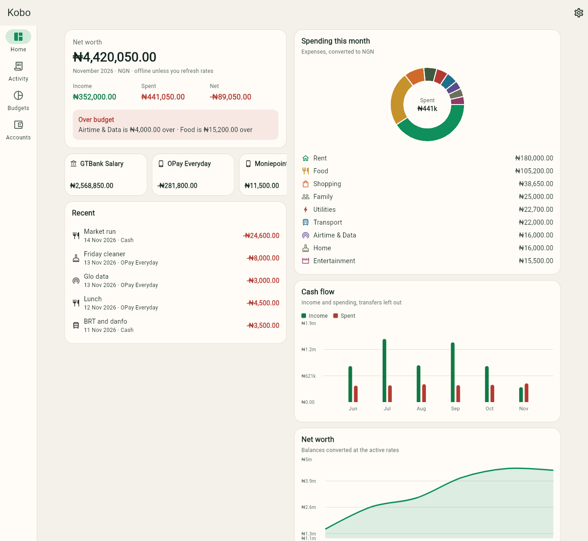
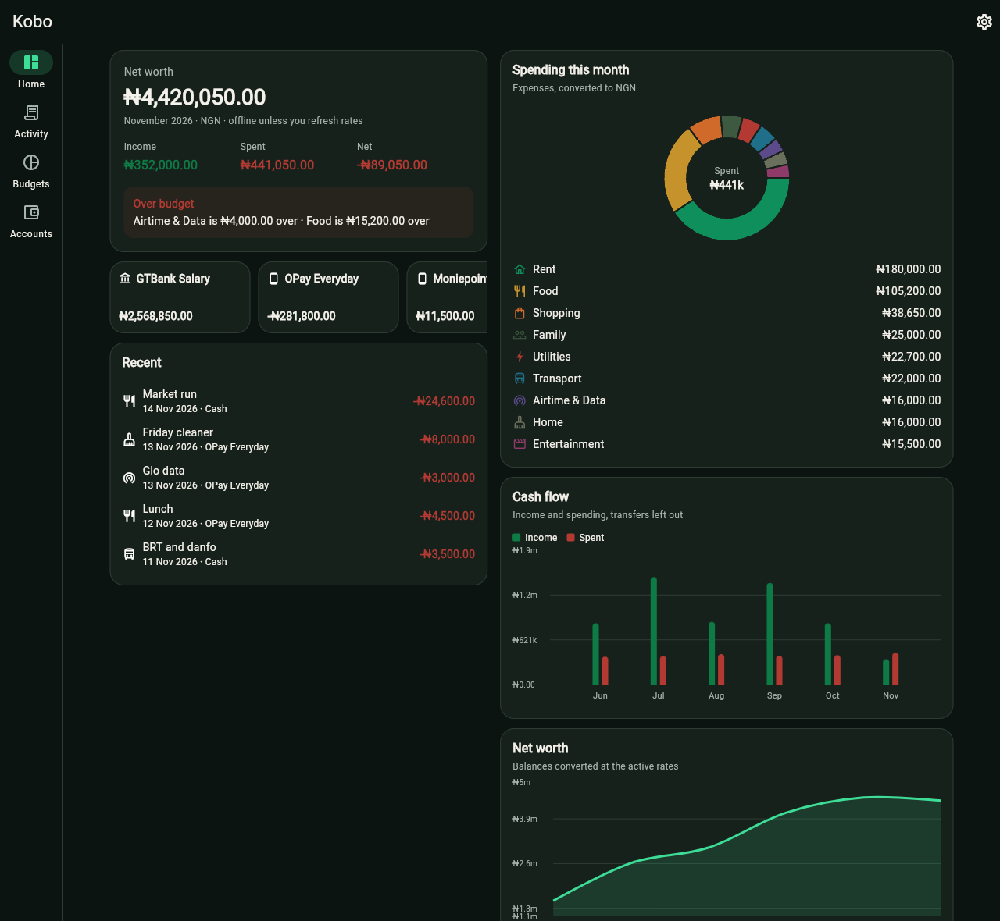
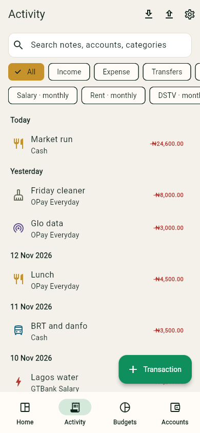
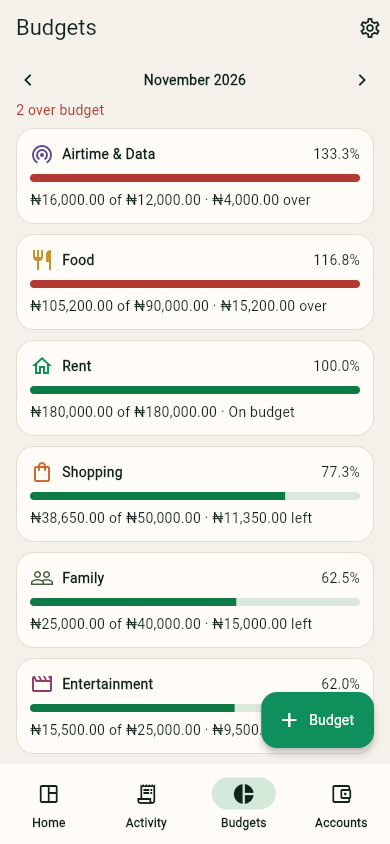
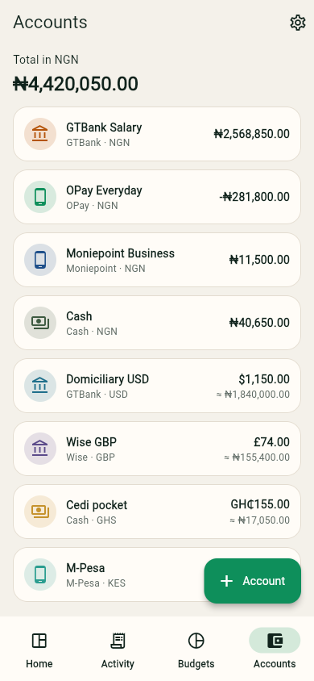
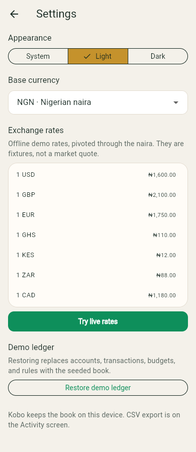
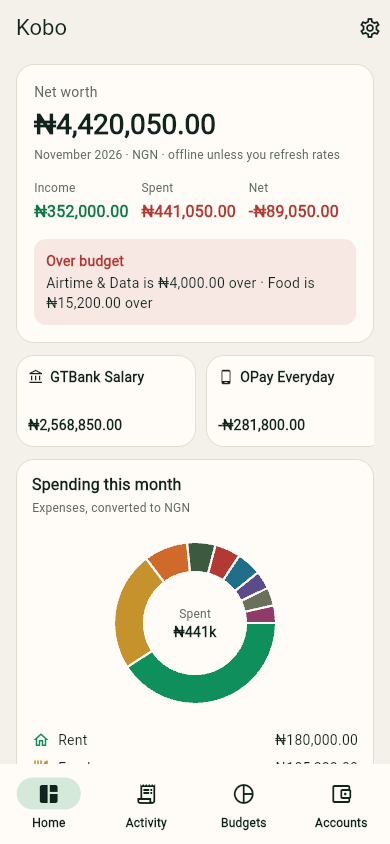
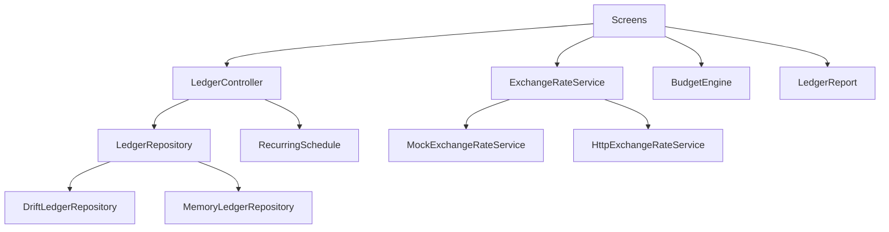

# Kobo

[](https://github.com/maikama8/finance-tracker-public/actions/workflows/ci.yml)

A personal ledger for money that does not sit in one currency. Salary lands in a GTBank account in naira, a freelance invoice lands in a domiciliary dollar account, and the Friday cleaner is paid from OPay. Kobo keeps those wallets, the categories, the monthly budgets, and the repeating postings on the device.

The first launch is a seeded book, not an empty form. The pictures below are that book on 14 November 2026, captured from the release web build. A later launch uses the device date, so the open month stays current. The naira totals in the tests are the 14 November figures.



On that date the book is worth **₦4,420,050.00**. November income so far is **₦352,000.00**, which is the $220 freelance invoice at the offline rate. Spending is **₦441,050.00**, so the month is **₦89,050.00** short. Payday is the 28th and has not posted yet. Airtime is ₦4,000.00 over its limit and food is ₦15,200.00 over.











The phone dashboard is the same book with the bottom navigation:



## Features

- Accounts for cash, bank, and mobile money (OPay, Moniepoint, and anything else you name)
- Income, expense, and transfer transactions with categories and notes
- Repeating transactions: weekly, monthly, and yearly, with short months clamped
- A monthly budget per category, a progress bar, and an over-budget alert
- NGN as the default base, plus USD, GBP, EUR, GHS, KES, ZAR, and CAD
- A pluggable `ExchangeRateService`. The app ships `MockExchangeRateService` (offline fixtures) and `HttpExchangeRateService` (open.er-api.com, fetched only when you ask)
- Dashboard charts for spending by category, six-month cash flow, and net worth
- Search, and filters by kind, account, and category
- CSV export and import
- Light, dark, and system theme
- Naira formatting, with the symbol and grouped kobo: `₦1,600.00`

## Tech stack

- Flutter 3.47 / Dart 3.13 (stable), null-safe
- `flutter_riverpod` for app state
- Drift and SQLite for the book. Web uses the vendored `sqlite3.wasm` and `drift_worker.js`
- `fl_chart` for the three dashboard charts
- No account and no API key. The live rate button is optional and fails closed back to the offline table

Offline rates are rounded fixtures, pivoted through naira, not live quotes:

| Currency | Naira per 1 major unit |
| --- | ---: |
| NGN | 1 |
| USD | 1,600 |
| GBP | 2,100 |
| EUR | 1,750 |
| GHS | 110 |
| KES | 12 |
| ZAR | 88 |
| CAD | 1,180 |

So $1.00 is ₦1,600.00 and £1.00 is ₦2,100.00. Cross rates divide through that table.

## Architecture

Screens read a `LedgerSnapshot` from `LedgerController`. The controller talks to `LedgerRepository`. The app binds that to Drift. Tests bind it to an in-memory repository that runs the same seed and the same schedule. Budgets, balances, net worth, and the recurring dates are pure functions, so they do not need a widget or a database.



Amounts are minor units, two decimal places, stored as integers. A transaction keeps the currency it was posted in. A transfer also stores the destination amount computed once, so a later rate change does not rewrite the posting. Totals convert at read time with whichever `ExchangeRateService` is active. The offline table does not move, so the history stays put until you opt into live rates for the session.

## How the November numbers are produced

$220.00 is 22,000 cents. The offline table says one dollar is 1,600 naira, and both currencies have two decimal places, so the minor-unit conversion is `22000 * 1600 / 1 = 35,200,000` kobo, which is **₦352,000.00**. That is the only November income on the 14th.

Food posts six times in November and sums to **₦105,200.00** against a **₦90,000.00** limit. The percent is truncated to a tenth:

`105200 * 1000 / 90000 = 1168` tenths, shown as **116.8%**, **₦15,200.00** over.

Airtime is **₦16,000.00** of **₦12,000.00**, **133.3%**, **₦4,000.00** over. Rent is **₦180,000.00** of **₦180,000.00**, which is on budget and not over. Other months in the six-month window stay inside their limits. The tests lock these figures for 14 November 2026.

Rounding is half away from zero. £1.00 into dollars is `100 * 2100 / 1600 = 131.25`, which rounds to **131** cents, **$1.31**.

Monthly and yearly dates keep the start day and clamp to the last day of a short month. 31 January steps to 28 February, or 29 in a leap year, then back to 31 March. A weekly rule steps by seven days times the interval. Materializing a rule is idempotent: the posting id is `txn_{ruleId}_{yyyyMMdd}`, and `lastMaterializedOn` only moves forward, so deleting an old occurrence does not bring it back.

## Getting started

Install the stable Flutter SDK. This repo was built with 3.47.9. Then:

```bash
git clone https://github.com/maikama8/finance-tracker-public.git
cd finance-tracker-public
flutter pub get
flutter analyze
flutter test
flutter run
```

`flutter run -d chrome` starts the web build. `make analyze`, `make test`, and `make web` wrap the same commands. The web release build needs the two files already in `web/`:

- `sqlite3.wasm`
- `drift_worker.js`

They are the Drift web prerequisites for the pinned `drift` and `sqlite3` packages. After a schema change, regenerate the database code:

```bash
dart run build_runner build --delete-conflicting-outputs
```

The generated `lib/data/drift/app_database.g.dart` is committed, so CI does not run the generator.

On the web, the hash selects a screen: `#/dashboard`, `#/activity`, `#/budgets`, `#/accounts`, `#/settings`. `#/dashboard?theme=dark` opens the dark theme for a screenshot without writing it into the saved preference.

CSV columns, in order:

```text
id,date,kind,account,currency,amount,category,note,counter_account,destination_amount
```

Amounts are major units with two decimals. A field with a comma or a quote is quoted. Import matches accounts and categories by name, creates the ones it does not know, skips an id that already exists, and reports a bad row without dropping the rest.

## Project structure

```text
lib/
  main.dart                         ProviderScope and semantics on web
  app.dart                          MaterialApp, light and dark themes
  core/currency/                    Currencies, minor-unit rounding, ExchangeRateService
  core/formatting/                  Naira and other currency formatting
  core/navigation/                  Hash location for the web build
  data/drift/                       SQLite schema and DriftLedgerRepository
  data/memory_ledger_repository.dart
  data/seed/seed_data.dart          The opening book
  features/accounts/                Account model and screens
  features/transactions/            Transactions, search, recurring schedule
  features/budgets/                 Monthly limits and BudgetEngine
  features/dashboard/               Charts and LedgerReport
  features/import_export/           CSV
  features/settings/                Theme, base currency, rate table
  state/providers.dart              Riverpod wiring
  ui/                               Shell, theme, shared widgets
test/                               Conversion, budgets, schedule, seed, Drift, widgets
web/sqlite3.wasm                    Drift web module
web/drift_worker.js                 Drift web worker
.github/workflows/ci.yml            analyze, test, and web release build
```

## Testing

```bash
flutter analyze
flutter test
flutter build web --release
```

GitHub Actions (`.github/workflows/ci.yml`) runs those three on Flutter 3.47.9 for pushes to `main` and for pull requests.

The suite covers minor-unit rounding (including £1.00 to $1.31), the naira formatter, budget progress for under, exact, over, foreign expenses, and a zero limit, the weekly and monthly schedule including 31 January and 29 February, idempotent materialization, the seeded November overs, account balances with a cross-currency transfer, CSV quoting, the Drift repository, and the dashboard, activity search, budgets, accounts, and theme screens.

## Roadmap

- Edit one occurrence of a repeating rule without forking the rule
- A per-transaction exchange rate, for the day the bank actually used
- Attachments on a transaction
- A budget that is not the same every month
- Reminders before a repeating posting
- Sync, once there is an account. This app is offline on purpose

## Author

**Abdulrasheed Oseni** ([@maikama8](https://github.com/maikama8)), Zarachtech.

This repository is a public portfolio project.

## License

[MIT](LICENSE). Copyright (c) 2026 Abdulrasheed Oseni.
